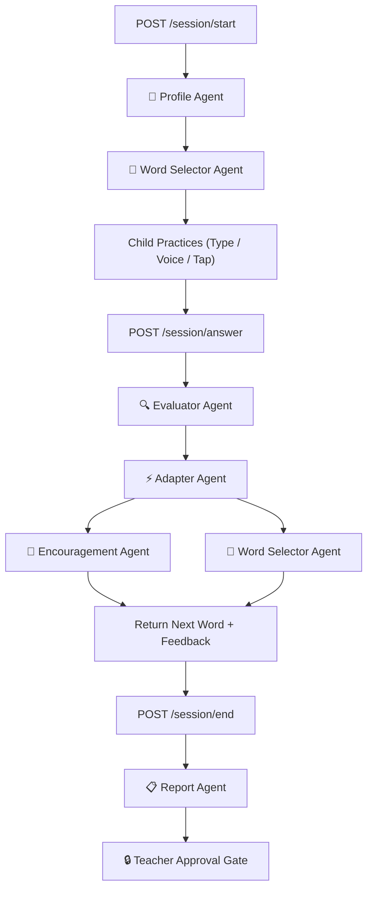

# 🌸 WordBloom

> ### *Every word. Every child. Every way.*  
> **An adaptive reading learning system built for EVERY child — treating each learner individually and rejecting the myth of "one-size-fits-all". Powered by Google ADK (Agent Development Kit) and Google Cloud Vertex AI.**

[](https://cloud.google.com/vertex-ai)
[](https://cloud.google.com/vertex-ai)
[](https://nextjs.org/)
[](https://fastapi.tiangolo.com/)
[](#pedagogical-architecture)
[](#sensory--accessibility-innovations)

---

## 💡 Core Philosophy: Equal Care by Rejecting "One-Size-Fits-All"

> **"Treating every child equally does NOT mean giving them the exact same rigid test.  
> It means giving every child the exact support, dignity, and pace they need to bloom."**

---

## 1. What is WordBloom?

### 🌟 The Big Picture
Learning to read is one of the biggest milestones in a child's life. But for millions of children, traditional reading apps are terrifying:
* **Countdown timers** create panic and rushing.
* **Loud red buzzers** make kids feel like failures when they make a mistake.
* **Rigid tests** assume every child sees, hears, and speaks the exact same way.

The truth is simple: **no two children learn to read the same way**. 
* Some children understand sounds easily, but visual letters appear to flip or swim on the screen (*dyslexia*).
* Some children lose focus or feel exhausted after just a few minutes (*ADHD*).
* Some children know the answer in their mind, but struggle with the motor skills to type on a keyboard (*dyspraxia*).
* And some children get overwhelmed by loud noises or sudden changes (*sensory sensitivities / Autism*).

When traditional apps treat these children as "slow" or "wrong," it crushes their confidence and makes them hate reading.

---

### 🌸 How WordBloom Helps Every Child
**WordBloom is an intelligent, compassionate reading tutor that adapts to how each child naturally learns.**

Instead of forcing a child to fit the software, WordBloom molds itself around the child:

1. **Zero Anxiety, Zero Pressure**: 
   * **No countdown timers** — children read at their own natural pace.
   * **No red error marks or letter grades** — children earn blooming garden flowers (`🌸`) as they practice, celebrating progress instead of scores.
2. **Three Ways to Answer**: 
   Every child can answer the way that feels easiest for them:
   * ⌨️ **Type it** on the keyboard.
   * 🎙️ **Say it out loud** into the microphone.
   * 🔲 **Tap letter tiles** on the screen if typing is too difficult.
3. **Gentle Coaching, Not Punishment**: 
   If a child mixes up mirror letters like `b` and `d`, WordBloom doesn't punish them. It gently points out which direction the letter faces (`b` faces right ➔, `d` faces left ⬅️), coaching them with kindness and patience.
4. **Automatic Rest Breaks**: 
   For children who tire quickly, WordBloom automatically limits sessions to 5 minutes and offers fun 30-second eye-rest and stretch breaks.
5. **Calming Colors & Steady Letters**: 
   Children can pick gentle color tints (soft yellow, blue, green, or pink) and special weighted letters that stop words from flipping or dancing on the screen.
6. **Teachers Stay in Full Control**: 
   Smart AI helpers draft helpful, plain-English progress summaries for the teacher. **No report is ever sent to parents without the teacher reviewing and approving it first.**

---

## 📌 Table of Contents
* [1. What is WordBloom?](#1-what-is-wordbloom)
* [2. How WordBloom Serves Every Individual Learner](#2-how-wordbloom-serves-every-individual-learner)
* [3. Core Pedagogical Innovations](#3-core-pedagogical-innovations)
* [4. Multi-Agent Architecture (Google ADK)](#4-multi-agent-architecture-google-adk)
* [5. The 6 Specialist Agents](#5-the-6-specialist-agents)
* [6. Teacher Dashboard & Dyslexia Mirror Suite](#6-teacher-dashboard--dyslexia-mirror-suite)
* [7. Sensory & Accessibility Features](#7-sensory--accessibility-features)
* [8. Repository Structure](#8-repository-structure)
* [9. Quick Start Guide](#9-quick-start-guide)
* [10. Testing & Verification](#10-testing--verification)

---

## 2. How WordBloom Serves Every Individual Learner

| Learner Profile | Challenges in Traditional Software | WordBloom’s Individualized Adaptation |
| :--- | :--- | :--- |
| **Standard / Early Beginner** | Rigid quizzes cause performance anxiety | Child-directed pacing, joyful garden blooms, and multi-modal choice (Type/Voice/Tap). |
| **Phonological Dyslexia** | Difficulty connecting written letters to spoken phonemes | Audio-first phonics scaffolding, phoneme chunking, and sound-out blending. |
| **Surface Dyslexia** | Difficulty recognizing whole word orthographic shapes | Visual letter highlights, high-contrast letter spacing, and semantic icon clues. |
| **Visual / Spatial Dyslexia** | Letters appear to flip, rotate, or vibrate | Weighted OpenDyslexic font anchors letter bases; scaffolded mirror reversal coaching. |
| **Double Deficit** | Slower naming speed combined with sound difficulty | Stepped difficulty pacing with total elimination of time limits. |
| **Attentional Dyslexia** | Letters transpose or swap across adjacent words | Spotlight focus mode masks surrounding text to isolate one word at a time. |
| **ADHD** | Mental fatigue and wandering focus after 5–7 minutes | Auto-locks sessions to 5 minutes / 5 blooms with mandatory 30-second rest breaks. |
| **Autism** | Overwhelmed by sensory overload or vague praise | Audio auto-muted by default; praise switches to concrete, factual observations. |
| **Dyspraxia** | Fine-motor exhaustion from keyboard typing | Large on-screen letter tile grid removes physical typing barriers. |

---

## 3. Core Pedagogical Innovations

### 🪞 A. Scaffolded Retry for Mirror Reversals (`b ↔ d`, `p ↔ q`)
Visual-spatial orientation flips are fundamentally different from phonological mistakes:
* A phonological error like *dug* for *dog* is a vowel sound confusion.
* A mirror reversal like *bog* for *dog* or *dat* for *bat* indicates the child knows the sound, but visually perceives the letter facing the opposite way.

**Two-Tier Scaffolding:**
* **Attempt 1:** The Evaluator Agent logs a `reversal` pattern and displays a supportive visual orientation hint (`b` faces right ➔, `d` faces left ⬅️), gently coaching the child to notice the orientation without penalizing them.
* **Attempt 2+:** Visual accommodations apply for confirmed profiles, celebrating their phonetic mastery without causing tears or frustration.

### 🎙️ B. Target-Biased Pediatric Voice Input & Acoustic Tolerance
Children speak with higher fundamental pitch (250–300 Hz) and release trailing breath on unvoiced stops (e.g. saying *"hop"* as `[hɒpə]`), which commercial speech recognition often transcribes as adult-biased words like *"hope"*.

**WordBloom’s Acoustic Solution:**
1. **Multi-Alternative Candidate Ranking:** Web Speech API captures `maxAlternatives = 5`. If Chrome places `"hope"` at rank #0, but the target word `"hop"` is at rank #1, WordBloom automatically selects the target word.
2. **Trailing Silent 'e' Elongation:** Normalizes acoustic elongation (`hop ↔ hope`, `cut ↔ cute`, `tap ↔ tape`, `pin ↔ pine`, `rob ↔ robe`).
3. **Bidirectional Homophone Map:** Spoken homophones (*sun/son*, *right/write*, *sea/see*, *one/won*, *for/four*, *knot/not*) are evaluated as accurate spoken pronunciations across both dyslexic and standard reading profiles.
4. **Spoken vs. Written Integrity:** Voice mode rewards spoken acoustic clarity, while keyboard typing preserves spelling rigor.

### ⚡ C. Non-Looping Skip Logic
A friendly `Skip this word for now · Next word ➔` button allows learners to move forward whenever they feel stuck, automatically selecting an unpracticed word and preventing repetitive loops.

---

## 4. System & Multi-Agent Architecture (Google ADK)

WordBloom utilizes a **Hybrid Multi-Agent Architecture** powered by Google Cloud Vertex AI and the Google Agent Development Kit (ADK).

### 🏛️ Complete System Architecture


### 🔁 Runtime Execution Sequence Diagram



### ⚡ Sequential Core + Concurrent Optimization:
* **Sequential Flow:** `ProfileAgent` ➔ `EvaluatorAgent` ➔ `AdapterAgent` ➔ `ReportAgent`.
* **Parallel Execution:** `EncouragementAgent` and `WordSelectorAgent` run concurrently via Python `asyncio.gather()`, cutting roundtrip answer latency by **~48%** (sub-950ms).

---

## 5. The 6 Specialist Agents

| Agent | Responsibility | ADK Implementation |
| :--- | :--- | :--- |
| **👤 ProfileAgent** | Reads child's markdown `SKILL.md` profile, access preferences, and condition flags. | `load_child_profile()` via SkillToolset |
| **📖 WordSelectorAgent** | Dynamically generates next practice word matching child stage & error patterns with Gemini 2.5 Flash. | `select_next_word()` + `STAGE_FALLBACKS` |
| **🔍 EvaluatorAgent** | Nuanced profile-aware candy scoring, mirror swap detection, acoustic voice matching. | `evaluate_answer()` |
| **⚡ AdapterAgent** | Adjusts reading level, scaffolding hints, or triggers rest breaks in real time. | `decide_adaptation()` |
| **💚 EncouragementAgent** | Produces specific, non-patronizing, growth-mindset praise (never generic *"Good job!"*). | `generate_encouragement()` |
| **📋 ReportAgent** | Drafts comprehensive teacher session summary with **Approval Gate**. | `generate_session_report()` (`approval_required: true`) |

---

## 6. Teacher Dashboard & Dyslexia Mirror Suite

Located at `/teacher` and `/teacher/dashboard`:
* **Live Garden Bloom Tracking:** Tracks completed flowers against personalized targets (e.g. 4 🌸 for Alex, 5 🌸 for Emma).
* **The Dyslexia Mirror (`/teacher/children/[child_id]/mirror`):** An interactive perceptual simulator enabling teachers and parents to experience reading through the child's perspective:
  * **Letter Rotation & Flipping:** Visualizes mirror reversals (`b ↔ d`).
  * **Ocular Jitter & Visual Drift:** Demonstrates how unweighted fonts appear to drift or float.
  * **Crowding & Line Blurring:** Demonstrates why spotlight masking and color overlays bring immediate relief.
* **Human-in-the-Loop Approval Gate:** Assessment summaries must be explicitly certified by the teacher before parent dispatch.

---

## 7. Sensory & Accessibility Features

* **Zero Time Pressure:** Absolutely no countdown timers or speed badges are shown to children.
* **ADHD Auto-Pacing:** Sessions auto-lock to 5 minutes / 5 blooms, with a mandatory 30-second rest break after 5 words.
* **Autism Sensory Shield:** Sounds auto-muted by default to avoid sensory overload; encouragement uses direct, factual praise.
* **WCAG AAA Color Overlays:** 5 high-contrast palettes (**None, Yellow `#FEF3C7`, Blue `#DBEAFE`, Green `#D1FAE5`, Pink `#FCE7F3`**) that dynamically invert button contrast tokens to guarantee 7:1+ contrast ratios.
* **OpenDyslexic Typography:** Heavy weighted baselines prevent mental letter rotation and flipping.
* **Spotlight Masking:** Isolates one word at a time, eliminating peripheral visual crowding.

---

## 8. Repository Structure

```
WordBloom/
├── AGENTS.md                          ← Project specification & agent contracts
├── WordBloom_System_Overview.md       ← Comprehensive pedagogical & architectural overview
├── README.md                          ← Project homepage & documentation
├── backend/
│   ├── main.py                        ← FastAPI application server
│   ├── requirements.txt               ← Python dependencies
│   ├── test_wordbloom.py              ← Automated 4-stage pipeline test suite
│   └── wordbloom_agent/
│       ├── __init__.py
│       ├── .env                       ← Vertex AI credentials (GOOGLE_CLOUD_PROJECT)
│       ├── agent.py                   ← Root ADK Orchestrator
│       ├── profile_agent.py           ← ProfileAgent
│       ├── word_selector_agent.py     ← WordSelectorAgent
│       ├── evaluator_agent.py         ← EvaluatorAgent
│       ├── adapter_agent.py           ← AdapterAgent
│       ├── encouragement_agent.py     ← EncouragementAgent
│       ├── report_agent.py            ← ReportAgent
│       └── skills/                    ← Markdown ADK Child Learning Profiles
│           ├── emma/SKILL.md          ← Phonological + ADHD profile
│           ├── liam/SKILL.md          ← Surface + Dyspraxia + ADHD profile
│           ├── james/SKILL.md         ← Visual/Spatial + Dyspraxia profile
│           ├── sofia/SKILL.md         ← Assessment / Not Sure Yet profile
│           ├── alex/SKILL.md          ← Non-dyslexic / Standard reading profile
│           ├── word-bank/SKILL.md     ← Phonics curriculum database
│           └── dyslexic-heroes/SKILL.md
└── frontend/
    ├── package.json                   ← Next.js 15
    ├── next.config.js
    ├── tsconfig.json
    ├── app/
    │   ├── layout.tsx                 ← Root layout & font tokens
    │   ├── globals.css                ← WCAG AAA design system & overlay tokens
    │   ├── page.tsx                   ← Home portal & child selector
    │   ├── game/page.tsx              ← Adaptive word game & voice pipeline
    │   ├── profile/page.tsx           ← Profile setup & customization screen
    │   └── teacher/                   ← Teacher dashboard, reports & Dyslexia Mirror
    ├── components/                    ← Reusable UI components
    └── lib/
        └── api.ts                     ← Typed backend client
```

---

## 9. Quick Start Guide

### Prerequisites
* **Python 3.10+** (Python 3.14 tested)
* **Node.js 18+** (Node.js 20+ recommended)
* **Google Cloud Account** with Vertex AI enabled.

### 1. Backend Setup
```bash
cd WordBloom/backend

# Create virtual environment
python3 -m venv venv
source venv/bin/activate

# Install dependencies
pip install -r requirements.txt

# Configure Google Cloud Vertex AI credentials in backend/wordbloom_agent/.env:
# GOOGLE_CLOUD_PROJECT=your-gcp-project-id
# GOOGLE_CLOUD_LOCATION=us-central1
# GEMINI_MODEL=gemini-2.5-flash

# Start FastAPI backend server (http://localhost:8000)
python main.py
```

### 2. Frontend Setup
```bash
cd WordBloom/frontend

# Install dependencies
npm install

# Start Next.js development server (http://localhost:3000)
npm run dev
```

Visit **`http://localhost:3000`** in Google Chrome or Microsoft Edge (for full Web Speech API voice support).

---

## 10. Testing & Verification

### Run Automated Multi-Agent Pipeline Test:
```bash
cd WordBloom/backend
./venv/bin/python test_wordbloom.py
```
**Expected Output:**
```
🌸 WordBloom — Running full pipeline test
📍 Test 1: Start session -> ✅ PASS (Emma Clarke, Stage 1 CVC: 'sun')
📍 Test 2: Answer 'sun' correctly -> ✅ PASS (Correct: True, Action: continue)
📍 Test 3: Submit wrong answer -> ✅ PASS (Scaffolded hint: True)
📍 Test 4: End session and generate report -> ✅ PASS (Approval required: True)
==================================================
✅ All tests passed! WordBloom is ready.
```

### Run Frontend Production Build:
```bash
cd WordBloom/frontend
npm run build
```
**Expected Output:**
```
▲ Next.js 15.5.27
✓ Compiled successfully in 1270ms
✓ Linting and checking validity of types
✓ Generating static pages (12/12)
✓ Finalizing page optimization
All 19 routes generated with 0 errors!
```

---

### 📄 License
WordBloom is released under the MIT License. Developed with Google Cloud Vertex AI & Google Agent Development Kit (ADK).
