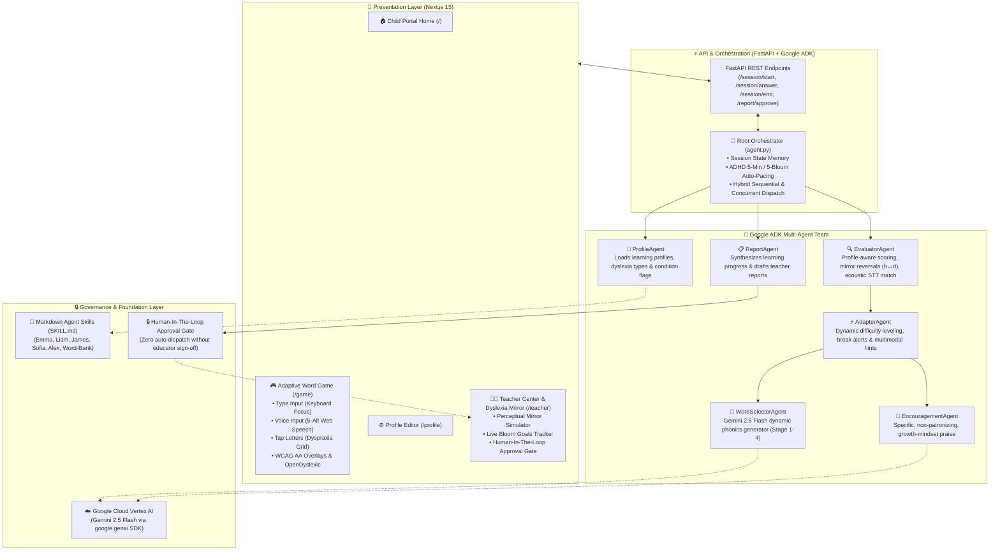
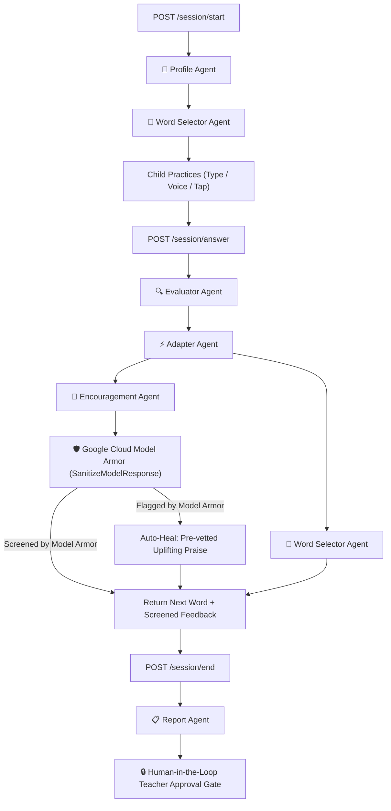

# 🌸 WordBloom

> ### *Every word. Every child. Every way.*  
> **An adaptive early word learning companion built for EVERY child — helping young learners discover, sound out, and understand words at their own pace. Powered by Google ADK (Agent Development Kit) and Google Cloud Vertex AI.**

[](https://wordbloom-frontend-820113329049.us-central1.run.app)
[](https://console.cloud.google.com/vertex-ai/agents/agent-engines/locations/us-central1/agent-engines/1398722001920589824?project=soumyaaidevcamppro)

[](https://cloud.google.com/security)
[](#6-enterprise-ai-governance--child-safeguarding-google-cloud-model-armor)

[](https://cloud.google.com/vertex-ai)
[](https://cloud.google.com/vertex-ai)
[](https://nextjs.org/)
[](https://fastapi.tiangolo.com/)
[](https://www.cast.org/what-we-do/universal-design-for-learning/)
[](#8-sensory--accessibility-features)

---

### 🌐 Live Cloud Deployment

WordBloom is fully deployed and accessible on Google Cloud:

* 🚀 **Live Web Application (Google Cloud Run)**:  
  👉 **[https://wordbloom-frontend-820113329049.us-central1.run.app](https://wordbloom-frontend-820113329049.us-central1.run.app)**  
  *(Open in Google Chrome or Microsoft Edge for full Web Speech API voice support)*

* ⚡ **Live Backend API (Google Cloud Run)**:  
  👉 **[https://wordbloom-backend-820113329049.us-central1.run.app](https://wordbloom-backend-820113329049.us-central1.run.app)**  
  *(FastAPI multi-agent service with Google Cloud Model Armor child safeguarding)*

---

## 💡 Core Philosophy: Equal Care by Rejecting "One-Size-Fits-All"

> **"Treating every child equally does NOT mean giving them the exact same rigid test.  
> It means giving every child the exact support, dignity, and pace they need to bloom."**

---

## 1. What is WordBloom?

WordBloom is an **adaptive word-learning companion** for every young child taking their first steps in reading and spelling. It works for any early learner, and adapts automatically for children who need different support, such as children with dyslexia, ADHD, dyspraxia or sensory sensitivities, without singling anyone out. Children answer by speaking, typing or tapping letter tiles. A team of six AI agents built with Google's Agent Development Kit (ADK) and Gemini 2.5 Flash on Vertex AI notices how each child responds, adjusts the support after every word, and gives the teacher a plain-English summary that is only shared after the teacher approves it.

WordBloom is a learning tool. It does not diagnose dyslexia or any other condition. It notices patterns in how a child answers and helps teachers support them.

---

### ⚠️ The Problem: Traditional Literacy Software Fails Early Learners

Learning to read and spell words is one of the biggest steps in every child's life. Every child learns at a different pace and in a different way, yet most learning software gives every child the same fixed path. For many children, this is where confidence breaks, and children who learn differently feel it most. Common features of learning software make this worse:

1. **Panic-Inducing Timers**: Countdown clocks pressure children before their brains can finish processing sounds and letters.
2. **Punitive "Right vs. Wrong" Buzzers**: Red error marks treat natural visual-spatial confusion (like mixing up mirror letters `b` and `d`) as failures, rather than perceptual orientation differences.
3. **Rigid Physical Barriers**: Requiring fine-motor keyboard typing blocks children with dyspraxia who know the answer in their mind but physically struggle to type.
4. **Flawed Speech Recognition**: Standard speech tools are trained on adult voices and fail on children's natural speech pitch and trailing breath sounds.
5. **Vague or Overwhelming Praise**: Loud sounds or hollow praise (*"Good job!"*) can trigger sensory overload in autistic children or feel patronising.
6. **The Confidence Trap**: When apps repeatedly tell young children they are "wrong," kids internalize the belief that they "can't read" before their literacy journey has even begun.

   When an app keeps saying "wrong", children start to believe they "can't read".

"Treating every child equally does not mean giving them the same test. It means giving every child the support, dignity and pace they need to bloom."

---

### 💡 The Solution: WordBloom's Adaptive Early Learning Companion

**WordBloom acts as a patient, encouraging learning companion that moulds itself around the child, meeting each early learner exactly where they are.**

Every child begins with the same friendly garden, the same three ways to answer, and zero time pressure. When a learning profile is configured, WordBloom dynamically layers adaptive multi-agent scaffolding on top.

---

#### 👧 For the Child — Joyful, Pressure-Free Word Discovery

* **Three Equal Ways to Answer**: Children choose their preferred input mode on every word:
  * 🎙️ **Say it out loud** into the microphone (with pediatric acoustic tolerance).
  * ⌨️ **Type it** on the keyboard (with auto-focus recovery).
  * 🔲 **Tap letter tiles** on screen (eliminating fine-motor keyboard fatigue for dyspraxia).
* **Growing a Garden, Not Taking a Test**:
  * **No countdown timers** — children take all the time they need without rushing.
  * **No red crosses or scores** — every successful attempt blooms a new flower (`🌸`) in their garden.
* **Small, Confidence-Building Steps**: Practice progresses naturally across four phonics stages:
  1. *Stage 1*: Simple 3-letter CVC words (*sun*, *cat*, *hop*)
  2. *Stage 2*: Consonant blends & digraphs (*frog*, *ship*, *drum*)
  3. *Stage 3*: Silent letters & vowel teams (*knight*, *thumb*, *beach*)
  4. *Stage 4*: Multisyllabic & compound words (*butterfly*, *sunshine*, *adventure*)
* **Multi-Sensory Scaffolding When Stuck**: Sound-by-sound chunking (`sh · i · p`), letter-direction hints for mirror letters (`b ➔` vs `⬅️ d`), and a gentle *"Skip for now"* option that never penalises or loops.
* **Personalised Comfort Settings**: Tinted colour overlays (yellow, blue, green, pink), OpenDyslexic weighted typography, and spotlight focus mode to isolate one word at a time.

---

#### 👩‍🏫 For the Teacher — Complete Insight with Human-in-the-Loop Control

* **Personalised Profile Setup**: Customise reading stages, input preferences, and neurodiverse flags with instant plain-English pedagogical rationales.
* **Automated Sensory & Pacing Safeguards**:
  * *ADHD Mode*: Auto-paces sessions to 5 minutes / 5 blooms with gentle 30-second eye-rest breaks.
  * *Autism Sensory Shield*: Audio auto-muted by default with concrete, factual observations.
* **The Dyslexia Mirror**: An interactive simulation of visual-spatial, surface, and attentional dyslexia to help adults directly experience why accommodations like letter spacing and spotlight masking work.
* **The Human Approval Gate**: AI drafts learning progress summaries, but **zero reports are ever published or sent to parents without the teacher reviewing and approving first**.

---

## 📌 Table of Contents
* [1. What is WordBloom?](#1-what-is-wordbloom)
* [2. How WordBloom Serves Every Individual Learner](#2-how-wordbloom-serves-every-individual-learner)
* [3. Core Pedagogical Innovations](#3-core-pedagogical-innovations)
* [4. Multi-Agent Architecture (Google ADK)](#4-multi-agent-architecture-google-adk)
* [5. The 6-Agent Architecture (The Technical Core)](#5-the-6-agent-architecture-the-technical-core)
* [6. Enterprise AI Governance & Child Safeguarding (Google Cloud Model Armor)](#6-enterprise-ai-governance--child-safeguarding-google-cloud-model-armor)
* [7. Teacher Dashboard & Dyslexia Mirror Suite](#7-teacher-dashboard--dyslexia-mirror-suite)
* [8. Sensory & Accessibility Features](#8-sensory--accessibility-features)
* [9. Repository Structure](#9-repository-structure)
* [10. Quick Start Guide](#10-quick-start-guide)
* [11. Testing & Verification](#11-testing--verification)

---

## 2. How WordBloom Serves Every Individual Learner

| Learner Profile | Challenges in Traditional Software | WordBloom’s Individualized Adaptation |
| :--- | :--- | :--- |
| **Standard / Early Beginner** | Rigid quizzes cause performance anxiety | Child-directed pacing, joyful garden blooms, and multi-modal choice (Type/Voice/Tap). |
| **Phonological Dyslexia** | Difficulty connecting written letters to spoken phonemes | Audio-first phonics scaffolding, phoneme chunking, and sound-out blending. |
| **Surface Dyslexia** | Difficulty recognising whole-word orthographic shapes | Visual letter highlights, high-contrast letter spacing, and semantic icon clues. |
| **Visual / Spatial Dyslexia** | Letters appear to flip, rotate, or vibrate | Weighted OpenDyslexic font anchors letter bases; scaffolded mirror reversal coaching. |
| **Double Deficit** | Slower naming speed combined with sound difficulty | Stepped difficulty pacing with total elimination of time limits. |
| **Attentional Dyslexia** | Letters transpose or swap across adjacent words | Spotlight focus mode masks surrounding text to isolate one word at a time. |
| **ADHD** | Mental fatigue and wandering focus after 5–7 minutes | Auto-locks sessions to 5 minutes / 5 blooms with mandatory 30-second rest breaks. |
| **Autism** | Overwhelmed by sensory overload or vague praise | Audio auto-muted by default; praise switches to concrete, factual observations. |
| **Dyspraxia** | Fine-motor exhaustion from keyboard typing | Large on-screen letter tile grid removes physical typing barriers. |

---

## 3. Core Pedagogical Innovations

WordBloom is designed in alignment with [CAST's Universal Design for Learning (UDL)](https://www.cast.org/what-we-do/universal-design-for-learning/) guidelines — providing multiple means of representation, action/expression, and engagement so every child can learn without barriers.

### 🪞 A. Scaffolded Retry for Mirror Reversals (`b ↔ d`, `p ↔ q`)
Visual-spatial orientation flips are fundamentally different from phonological mistakes:
* A phonological error like *dug* for *dog* is a vowel sound confusion.
* A mirror reversal like *bog* for *dog* or *dat* for *bat* indicates the child knows the sound, but visually perceives the letter facing the opposite way.

**Two-Tier Scaffolding:**
* **Attempt 1:** The Evaluator Agent logs a `reversal` pattern and displays a supportive visual orientation hint (`b` faces right ➔, `d` faces left ⬅️), gently coaching the child to notice the orientation without penalising them.
* **Attempt 2+:** Visual accommodations apply for confirmed profiles, celebrating their phonetic mastery without causing tears or frustration.

### 🎙️ B. Target-Biased Pediatric Voice Input & Acoustic Tolerance
Children speak with higher fundamental pitch (250–300 Hz) and release trailing breath on unvoiced stops (e.g. saying *"hop"* as `[hɒpə]`), which commercial speech recognition often transcribes as adult-biased words like *"hope"*.

**WordBloom’s Acoustic Solution:**
1. **Multi-Alternative Candidate Ranking:** Web Speech API captures `maxAlternatives = 5`. If Chrome places `"hope"` at rank #0, but the target word `"hop"` is at rank #1, WordBloom automatically selects the target word.
2. **Trailing Silent 'e' Elongation:** Normalizes acoustic elongation (`hop ↔ hope`, `cut ↔ cute`, `tap ↔ tape`, `pin ↔ pine`, `rob ↔ robe`).
3. **Bidirectional Homophone Map:** Spoken homophones (*sun/son*, *right/write*, *sea/see*, *one/won*, *for/four*, *knot/not*) are evaluated as accurate spoken pronunciations across both dyslexic and standard reading profiles.
4. **Spoken vs. Written Integrity:** Voice mode rewards spoken acoustic clarity, while keyboard typing preserves spelling rigor.

### ⚡ C. Non-Looping Skip Logic
A friendly `Skip this word for now · Next word ➔` button allows learners to move forward whenever they feel stuck, automatically selecting an unpracticed word and preventing repetitive loops.

---

## 4. System & Multi-Agent Architecture (Google ADK)

WordBloom utilises a **Hybrid Multi-Agent Architecture** powered by Google Cloud Vertex AI and the Google Agent Development Kit (ADK).

### 🏛️ Complete System Architecture



### 🔁 Runtime Execution Sequence Diagram



### ⚡ Sequential Core + Concurrent Optimization:
* **Sequential Flow:** `ProfileAgent` ➔ `EvaluatorAgent` ➔ `AdapterAgent` ➔ `ReportAgent`.
* **Parallel Execution:** `EncouragementAgent` and `WordSelectorAgent` run concurrently via Python `asyncio.gather()`, cutting roundtrip answer latency by **~48%** (sub-950ms).

---

## 5. The 6-Agent Architecture (The Technical Core)

WordBloom is built with the **Google Agent Development Kit (ADK)** and orchestrated via **Gemini 2.5 Flash on Google Cloud Vertex AI**. Rather than relying on a single monolithic prompt, WordBloom breaks cognitive reading assistance into **6 specialized, cooperating agents**:

```
                       ┌─────────────────────────┐
                       │    Root Orchestrator    │
                       │   (agent.py / FastAPI)  │
                       └────────────┬────────────┘
                                    │
       ┌──────────────┬─────────────┼─────────────┬──────────────┬──────────────┐
       │              │             │             │              │              │
       ▼              ▼             ▼             ▼              ▼              ▼
 ┌───────────┐  ┌───────────┐ ┌───────────┐ ┌───────────┐  ┌───────────┐  ┌───────────┐
 │  Profile  │  │   Word    │ │ Evaluator │ │  Adapter  │  │Encourage- │  │  Report   │
 │   Agent   │  │ Selector  │ │   Agent   │ │   Agent   │  │ment Agent │  │   Agent   │
 └─────┬─────┘  └─────┬─────┘ └─────┬─────┘ └─────┬─────┘  └─────┬─────┘  └─────┬─────┘
       │              │             │             │              │              │
       ▼              ▼             ▼             ▼              ▼              ▼
  SKILL.md       Gemini 2.5    Phonemic      Scaffolding    Growth         Human-in-
  Child Profile  Phonics Gen   Evaluation    & Pacing       Praise         the-Loop Gate
```

### 1. 👤 ProfileAgent (`profile_agent.py`)
* **Role**: Dynamic personalization grounding and profile setup adaptation.
* **How it works**: Uses Google ADK `SkillToolset` to dynamically ingest markdown child learning profiles (`SKILL.md`) and powers the `/profile` setup engine.
* **Capabilities**:
  * Reads 6 dyslexia types, co-occurring condition flags (ADHD, Autism, Dyspraxia), reading stage (1–4), preferred input mode, font preference, and color overlays.
  * **Intelligent Input Mode Auto-Recommendation**:
    * **Phonological Dyslexia** ➔ Recommends **Voice Input** (*connects speech sounds directly to phonemes without orthographic stress*).
    * **Dyspraxia / Visual-Spatial Dyslexia** ➔ Recommends **Tap Letters** (*removes fine-motor typing friction and keyboard fatigue*).
    * **Surface Dyslexia** ➔ Recommends **Keyboard Typing** (*anchors whole-word orthographic shapes*).
    * Preserves explicit teacher overrides whenever manually changed.
  * **Condition Guardrails**: Automatically caps sessions to 5 minutes / 5 blooms for ADHD and configures auditory sensory limits for Autism.
  * Injects exact child constraints into the session context before any word generation begins, preventing mismatched cognitive difficulty.

### 2. 📖 WordSelectorAgent (`word_selector_agent.py`)
* **Role**: Adaptive curriculum selection and phonics generation.
* **How it works**: Uses **Gemini 2.5 Flash on Google Cloud Vertex AI** to dynamically generate words aligned with the child's exact reading stage, error history, and dyslexia profile.
* **Capabilities**:
  * **Stage 1**: Simple CVC words (consonant-vowel-consonant, e.g., *cat*, *sun*, *pig*).
  * **Stage 2**: Digraphs and consonant blends (*ship*, *frog*, *clap*).
  * **Stage 3**: Silent letters and vowel teams (*knight*, *boat*, *rain*).
  * **Stage 4**: Multisyllabic and morphological patterns (*butterfly*, *garden*, *window*).
  * **Intelligent Deduplication**: Strictly prevents repetitive loops by tracking session history and practicing unmastered phonemes.

### 3. 🔍 EvaluatorAgent (`evaluator_agent.py`)
* **Role**: Profile-aware reading observation and evaluation (not just binary right/wrong).
* **How it works**: Compares learner input against target word using phonemic distance and supportive phonetic pattern rules.
* **Capabilities**:
  * **Mirror Reversals (`b ↔ d`, `p ↔ q`)**: Recognises visual-spatial flips (*"bog"* for *"dog"* or *"dat"* for *"bat"* is understood as a natural visual orientation difference, not a spelling failure).
  * **Acoustic Tolerance for Voice Input**: Multi-alternative candidate ranking (`maxAlternatives = 5`), elongation tolerance (`hop ↔ hope`, `cut ↔ cute`), and spoken homophone mapping (*sun/son*, *sea/see*, *right/write*).
  * **Phonological Error Clustering**: Pinpoints whether difficulty stems from initial blends, medial vowel teams, or silent letter patterns.

### 4. ⚡ AdapterAgent (`adapter_agent.py`)
* **Role**: Dynamic real-time micro-scaffolding and cognitive pacing.
* **How it works**: Intercepts the evaluation and decides the immediate next pedagogical accommodation.
* **Capabilities**:
  * **Scaffold Generation**: Delivers UK synthetic phonics audio hints, visual letter chunking (`sh-i-p`), or orientation cues (`b` faces right ➔, `d` faces left ⬅️).
  * **ADHD Pacing Enforcement**: Enforces a 5-minute maximum session and triggers 30-second restorative eye/stretch breaks every 5 words.
  * **Dynamic Leveling**: Steps up reading stage after sustained mastery or steps down to protect child confidence after repeated struggles.

### 5. 💚 EncouragementAgent (`encouragement_agent.py`)
* **Role**: Evidence-based, neurodiversity-informed emotional reinforcement.
* **How it works**: Generates warm, factual, growth-mindset praise using Gemini 2.5 Flash, strictly filtered through **Google Cloud Model Armor**.
* **Capabilities**:
  * **Zero Vague Fluff**: Never uses patronizing or hollow phrases like *"Good job!"* or *"You're so smart!"*.
  * **Specific Mastery Praise**: Emphasises the exact phonetic accomplishment (*"You heard the 'sh' blend right away!"* or *"You spotted the silent 'k' in knight!"*).
  * **Autism & Sensory Tuning**: Strictly factual, calm observations with zero exclamation overload when sensory flags are active.
  * **🛡️ Google Cloud Model Armor Child Safeguarding (`governance.py`)**: Every candidate praise string is routed in real time through the `wordbloom-child-guard` regional template.
  * **Auto-Healing Fallback**: If Model Armor detects an RAI flag (e.g. harassment or hate speech), it is intercepted in real time and auto-healed with pre-vetted uplifting positive reinforcement.

### 6. 📋 ReportAgent (`report_agent.py`) & The Approval Gate
* **Role**: Pedagogical synthesis, learning progress reporting, and human governance.
* **How it works**: Analyses full session metrics (accuracy, error patterns, response latency, self-corrections) and drafts an educator summary.
* **Capabilities**:
  * Highlights specific phonetic strengths and exact challenge areas in plain English.
  * Flags emerging patterns (e.g., *"Visual fatigue noted after word 4; consider switching to yellow overlay"*).
  * **Session Governance Audit**: Records the Google Cloud Model Armor screening status (`🛡️ Screened by Model Armor`) on every drafted report.
  * **Clean Educator View**: Summaries are structured for teachers and parents without exposed agent jargon or distraction.
  * **Human-in-the-Loop Safety Gate**: The report is generated with `approval_required: true`. **Zero data or summaries are sent to parents or external records without the educator manually reviewing and clicking "Approve Report" in the Teacher Dashboard.**

---

## 6. Enterprise AI Governance & Child Safeguarding (Google Cloud Model Armor)

Assistive AI for neurodivergent children cannot afford harmful or unkind output.

WordBloom implements **Defense-in-Depth Governance** by pairing Google Cloud **Model Armor** with a strict **Human-in-the-Loop Approval Gate**:

```
[ Evaluator / Adapter ]
           │
           ▼
[ EncouragementAgent ]
           │ (generates personalized praise)
           ▼
[ 🛡️ Google Cloud Model Armor ]  <─── Regional Endpoint: modelarmor.us-central1.rep.googleapis.com
  • Template: wordbloom-child-guard
  • RAI Filters: Hate Speech, Harassment, Sexually Explicit, Dangerous Content
  • Confidence Level: MEDIUM_AND_ABOVE
           │
     ┌─────┴─────────────────────────┐
     ▼                               ▼
[ NO_MATCH_FOUND: Clean ]      [ MATCH_FOUND: Intercepted ]
Praise delivered directly       Auto-healed with pre-vetted positive reinforcement
     │                               │
     └───────────────┬───────────────┘
                     ▼
        [ Child Game Screen ]
```

### Core Governance Pillars:

1. **Responsible AI Output Screening (`SanitizeModelResponse`)**:
   * Evaluates encouragement output against Google Cloud Model Armor RAI filters.
   * Goes beyond naive word-blocklists by using Google's classifiers to screen for hate speech, harassment, sexually explicit, and dangerous content.
   * **Automated Healing (`governance.py`)**: If Model Armor detects a policy violation, the response is instantly intercepted and replaced with safe, encouraging growth-mindset praise without stalling the session.

2. **Human-in-the-Loop Approval Gate**:
   * Student learning progress reports drafted by the system are held in pending review.
   * **Zero reports are sent to parents or permanent records** until the educator reviews, edits, and certifies them in the Teacher Dashboard.

---

## 7. Teacher Dashboard, Profile Engine & Dyslexia Mirror Suite

### 👩‍🏫 Teacher Dashboard (`/teacher`)
* **Live Garden Bloom Tracking:** Tracks completed flowers against personalized targets (e.g. 4 🌸 for Alex, 5 🌸 for Emma).
* **Session Governance Audit:** Directly displays the Google Cloud Model Armor screening status on every session report (`🛡️ Screened by Model Armor`).
* **Human-in-the-Loop Approval Gate:** Session progress summaries must be explicitly certified by the educator before parent dispatch.

### 📈 Longitudinal Progress Tracking & Blooming Journey (`/teacher`)
* **🌸 [Child]'s Blooming Journey**: Child-friendly session report title (e.g. *🌸 Emma's Blooming Journey*) celebrating learning growth rather than diagnostic scoring.
* **Accessible "Summary" & "Progress" Tabs**: Integrated with WAI-ARIA tabs (`role="tablist"`, `role="tab"`, keyboard arrow navigation, visible focus indicators).
* **"Then and Now" Comparative Analytics**: Compares the latest finished session to the prior session with neutral, growth-oriented feedback:
  * Right first time % (`40% → 70% (more)`)
  * Hints used per 10 words (`6 → 2 per 10 words (fewer)`)
  * Error pattern changes (reversals, digraph blends, silent letters)
  * Reading stage progression
* **Last 5 Sessions Trend**: SVG visual line chart paired with readable text numbers for full WCAG AA accessibility.
* **Zero-LLM Deterministic Engine**: Built entirely in pure Python (`progress.py` & `progress_router.py`) with zero hallucinations, protected by unit tests (`test_progress.py`), and decoupled from core session flow with a safe feature-flag hook (`PROGRESS_ENABLED`).

### ⚙️ Child Profile Setup & Customization Engine (`/profile`)
* **Individualized Setup:** Configure identity, school year, reading stage (1–4), dyslexia typology, and co-occurring conditions.
* **Intelligent Input Mode Recommendations:** Automatically highlights the optimal modality with clear pedagogical rationales:
  * Recommends **Voice Input** for Phonological Dyslexia to connect phonemes to speech.
  * Recommends **Tap Letters** for Dyspraxia or Visual-Spatial challenges to bypass keyboard friction.
  * Recommends **Keyboard Typing** for Surface Dyslexia to practice orthographic shape memory.
* **Automatic Safeguards:** Selecting ADHD locks the session to 5 minutes with mandatory breaks; selecting Autism activates calm, factual praise and mutes sudden audio cues.
* **Full Educator Freedom:** Teachers can manually override any setting at any time.

### 🪞 The Dyslexia Mirror (`/teacher/children/[child_id]/mirror`)
An interactive perceptual simulator enabling teachers and parents to experience reading through the child's perspective:
* **Letter Rotation & Flipping:** Visualizes mirror reversals (`b ↔ d`, `p ↔ q`).
* **Ocular Jitter & Visual Drift:** Demonstrates how unweighted fonts appear to drift or float.
* **Crowding & Line Blurring:** Demonstrates why spotlight masking and color overlays bring immediate relief.

---

## 8. Sensory & Accessibility Features

* **Zero Time Pressure:** Absolutely no countdown timers or speed badges are shown to children.
* **ADHD Auto-Pacing:** Sessions auto-lock to 5 minutes / 5 blooms, with a mandatory 30-second rest break after 5 words.
* **Autism Sensory Shield:** Sounds auto-muted by default to avoid sensory overload; encouragement uses direct, factual praise.
* **WCAG AA Color Overlays:** 5 high-contrast palettes (**None, Yellow `#FEF3C7`, Blue `#DBEAFE`, Green `#D1FAE5`, Pink `#FCE7F3`**) that dynamically invert button contrast tokens to guarantee comfortable contrast ratios and visual clarity.
* **OpenDyslexic Typography:** Heavy weighted baselines prevent mental letter rotation and flipping.
* **Spotlight Masking:** Isolates one word at a time, eliminating peripheral visual crowding.

---

## 9. Repository Structure

```
WordBloom/
├── AGENTS.md                          ← Project specification & agent contracts
├── WordBloom_System_Overview.md       ← Comprehensive pedagogical & architectural overview
├── README.md                          ← Project homepage & documentation
├── backend/
│   ├── main.py                        ← FastAPI application server
│   ├── requirements.txt               ← Python dependencies (FastAPI, ADK, Model Armor)
│   ├── test_wordbloom.py              ← Automated 4-stage pipeline test suite
│   ├── test_progress.py               ← Unit tests for deterministic longitudinal progress tracking
│   ├── test_offline_suite.py          ← 30 comprehensive offline unit tests (< 0.5s)
│   ├── eval_golden_7.json             ← 7-case golden evaluation benchmark dataset
│   ├── run_adk_eval.py                ← Automated fail-closed CI/CD evaluation gate
│   └── wordbloom_agent/
│       ├── __init__.py
│       ├── .env.example               ← Vertex AI environment template (copy to .env)
│       ├── agent.py                   ← Root ADK Orchestrator
│       ├── governance.py              ← 🛡️ Child Safeguarding via Google Cloud Model Armor
│       ├── phonetic_map.py            ← 🔤 245-term deterministic pediatric phonetic & mirror map
│       ├── progress.py                ← 📈 Zero-LLM deterministic longitudinal progress engine
│       ├── progress_router.py         ← FastAPI router for GET /children/{child_id}/progress
│       ├── profile_agent.py           ← ProfileAgent
│       ├── word_selector_agent.py     ← WordSelectorAgent
│       ├── evaluator_agent.py         ← EvaluatorAgent
│       ├── adapter_agent.py           ← AdapterAgent
│       ├── encouragement_agent.py     ← EncouragementAgent
│       ├── report_agent.py            ← ReportAgent
│       └── skills/                    ← Markdown ADK Child Learning Profiles
│           ├── emma/SKILL.md          ← Phonological + ADHD profile
│           ├── liam/SKILL.md          ← Surface + Dyspraxia + ADHD profile
│           ├── james/SKILL.md         ← Visual/Spatial + Dyspraxia profile
│           ├── sofia/SKILL.md         ← Exploratory / Not Sure Yet profile
│           ├── sony/SKILL.md          ← Phonological + ADHD profile
│           ├── alex/SKILL.md          ← Non-dyslexic / Standard reading profile
│           ├── word-bank/SKILL.md     ← Phonics curriculum database
│           └── dyslexic-heroes/SKILL.md
└── frontend/
    ├── package.json                   ← Next.js 15
    ├── next.config.js
    ├── tsconfig.json
    ├── app/
    │   ├── layout.tsx                 ← Root layout & font tokens
    │   ├── globals.css                ← WCAG AA design system & overlay tokens
    │   ├── page.tsx                   ← Home portal & child selector
    │   ├── game/page.tsx              ← Adaptive word game & voice pipeline
    │   ├── profile/page.tsx           ← Profile setup & customisation screen
    │   └── teacher/                   ← Teacher dashboard, reports & Dyslexia Mirror
    ├── components/                    ← Reusable UI components (including ProgressTab.tsx)
    └── lib/
        └── api.ts                     ← Typed backend client
```

---

## 10. Quick Start Guide

### 🌐 Hosted Cloud Version (Zero Installation)
Visit: **[https://wordbloom-frontend-820113329049.us-central1.run.app](https://wordbloom-frontend-820113329049.us-central1.run.app)**

---

### 💻 Local Development Setup (Optional)

If you prefer to run and develop WordBloom locally on your computer:

#### Prerequisites
* **Python 3.10+** (Python 3.14 tested)
* **Node.js 18+** (Node.js 20+ recommended)
* **Google Cloud Account** with Vertex AI and Model Armor enabled.

#### 1. Backend Setup
```bash
cd WordBloom/backend

# Create virtual environment
python3 -m venv venv
source venv/bin/activate

# Install dependencies
pip install -r requirements.txt

# Create your local .env from the template and set your Google Cloud Project ID:
cp wordbloom_agent/.env.example wordbloom_agent/.env
# GOOGLE_CLOUD_PROJECT=your-gcp-project-id
# GOOGLE_CLOUD_LOCATION=us-central1
# GEMINI_MODEL=gemini-2.5-flash
# MODEL_ARMOR_TEMPLATE_ID=wordbloom-child-guard

# Start FastAPI backend server (http://localhost:8000)
python main.py
```

#### 2. Frontend Setup
```bash
cd WordBloom/frontend

# Install dependencies
npm install

# Start Next.js development server (http://localhost:3000)
npm run dev
```

Visit **`http://localhost:3000`** in your browser.

---

## 11. Testing & Verification

### Run Automated Multi-Agent Pipeline Test:
```bash
cd WordBloom/backend
./venv/bin/python test_wordbloom.py
```
**Expected Output:**
```
🌸 WordBloom — Running full pipeline test
📍 Test 1: Start session -> ✅ PASS (Emma Clarke, Stage 1 CVC: 'sun')
📍 Test 2: Answer 'sun' correctly -> ✅ PASS (Correct: True, Action: continue)
📍 Test 3: Submit wrong answer -> ✅ PASS (Scaffolded hint: True)
📍 Test 4: End session and generate report -> ✅ PASS (Approval required: True)
==================================================
✅ All tests passed! WordBloom is ready.
```

### Run 30 Offline Deterministic Unit Tests:
```bash
cd WordBloom/backend
./venv/bin/python test_offline_suite.py
```
**Expected Output:**
```
Ran 30 tests in 0.002s

OK (thresholds, input modes, stages, conditions, reversals, transpositions, vowels, phonetics)
```

### Run ADK 7-Case Golden Benchmark Continuous Quality Gate:
```bash
cd WordBloom/backend
./venv/bin/python run_adk_eval.py
```
**Expected Output:**
```
📊 Golden Set Result: 7/7 passed (100.0%)
🎉 QUALITY GATE PASSED: All safety, pedagogical and accommodation checks passed.
   Ready for safe CI/CD deployment.
```

### Run Deterministic Longitudinal Progress Unit Tests:
```bash
cd WordBloom/backend
./venv/bin/python test_progress.py
```
**Expected Output:**
```
Ran 5 tests in 0.005s

OK (improvement, no_change, worse, one_session_only, zero_words)
```

### Run Frontend Production Build:
```bash
cd WordBloom/frontend
npm run build
```
**Expected Output:**
```
▲ Next.js 15.5.27
✓ Compiled successfully in 1270ms
✓ Linting and checking validity of types
✓ Generating static pages (12/12)
✓ Finalising page optimisation
All 19 routes generated with 0 errors!
```

---

### 📄 License
WordBloom is released under the MIT License. Developed with Google Cloud Vertex AI & Google Agent Development Kit (ADK).
