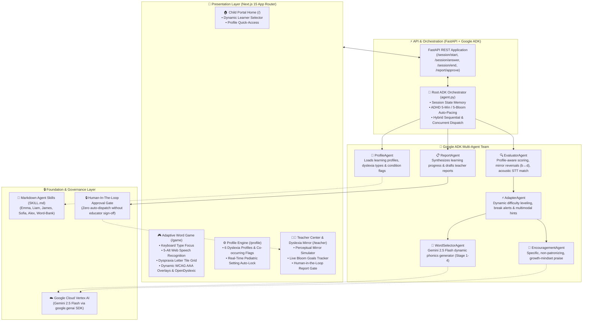
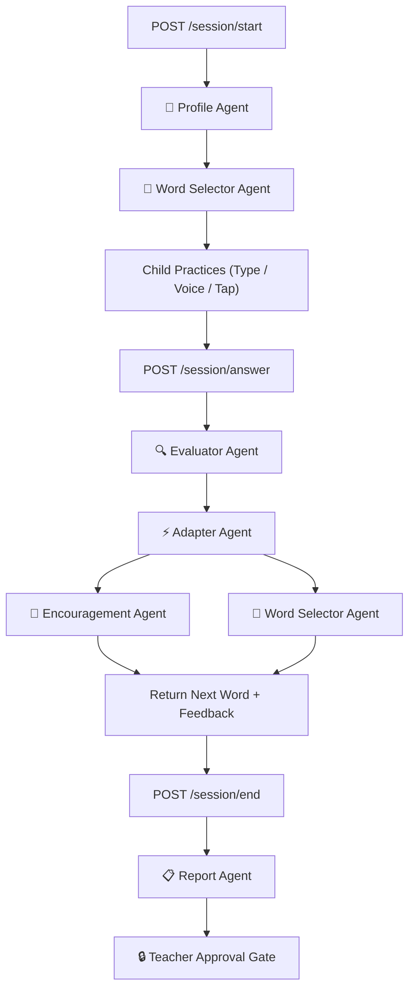

# 🌱 WordBloom — Adaptive Reading Learning System for ALL Children

> **Tagline**: *Every word. Every child. Every way.*  
> **Core Philosophy**: *Built for ALL children — not just the hypothetical "average" child.*

---

## 1. Executive Summary & Problem Space

**WordBloom** is an adaptive, AI-powered reading learning system engineered on the principles of **Universal Design for Learning (UDL)**.

Traditional literacy software is designed for a mythical "average child" — using rigid quizzes, countdown timers, speed pressures, and punitive one-size-fits-all grading. In reality, **no average child exists**. Children process orthography, phonology, and sensory stimuli along a wide spectrum.

When early readers first enter the **world of words and letters**, early failure experiences often trigger reading anxiety and learned helplessness. By solving directly for children with dyslexia, ADHD, Autism, and dyspraxia, WordBloom creates a **vastly superior, anxiety-free reading experience for ALL children** — beginner readers, neurotypical students, and neurodivergent learners alike.

Powered by a **Google Agent Development Kit (ADK)** multi-agent architecture and Google Cloud Vertex AI, WordBloom personalizes every session in real time across **6 dyslexia profiles**, **3 co-occurring conditions**, and **3 multi-modal interaction modes**, with every decision observable and explainable to educators in plain English.

---

## 2. Early Literacy & Phonics Progression

WordBloom guides learners step-by-step from foundational phoneme-grapheme mapping to fluent word decoding:

* **Stage 1 (Simple CVC Words)**: Consonant-vowel-consonant combinations with short vowels (e.g., *sun*, *hop*, *bat*, *cup*, *pin*, *net*, *fog*).
* **Stage 2 (Digraphs & Blends)**: Consonant blends and digraph letter pairs (e.g., *frog*, *clap*, *drum*, *ship*, *fish*, *path*, *jump*).
* **Stage 3 (Silent Letters & Vowel Teams)**: Complex orthographic rules and silent markers (e.g., *knight*, *thumb*, *wrist*, *knock*, *light*, *bread*).
* **Stage 4 (Multisyllabic & Compound Words)**: Compound structures and multi-syllable decoding (e.g., *sunshine*, *adventure*, *wonderful*, *together*, *explore*).

---

## 3. How WordBloom Helps Children with Learning Differences

Children with neurodivergent profiles experience reading in fundamentally distinct ways. WordBloom accommodates these differences through intentional pedagogical architecture:

### 🧩 A. Support for 6 Dyslexia Profiles
1. **Phonological Dyslexia**: Difficulty mapping visual letters to spoken sounds.  
   *Accommodations:* Phonics chunking, sound-out audio scaffolding, and auditory-first phoneme blending.
2. **Surface Dyslexia**: Difficulty recognizing whole word orthographic shapes (often over-relying on phonetic sounding out).  
   *Accommodations:* Visual letter highlights, high-contrast letter spacing, and meaning-association icons.
3. **Visual / Spatial Dyslexia**: Letters appear to rotate, mirror, drift, or vibrate on the screen.  
   *Accommodations:* Weighted OpenDyslexic font (heavy baselines anchor letters), customizable color overlays, and scaffolded mirror reversal guidance.
4. **Double Deficit**: Impairments in both phonological decoding and rapid automatized naming speed.  
   *Accommodations:* Complete elimination of time pressure, incremental difficulty pacing, and scaffolded multi-modal hints.
5. **Attentional Dyslexia**: Letters transpose, swap between adjacent words, or crowd together visually.  
   *Accommodations:* Spotlight focus mode (masks surrounding text, highlighting one word at a time).
6. **Assessment Mode ("Not Sure Yet")**: The multi-agent system assesses error patterns dynamically during the session, identifying whether mistakes are phonological, visual reversals, or silent letter omissions.

---

### 🪞 B. Scaffolded Retry for Mirror Reversals (`b ↔ d`, `p ↔ q`)
Visual/spatial errors differ fundamentally from phonological errors:
* A phonological error like *dug* for *dog* is a vowel sound confusion.
* A visual error like *bog* for *dog* or *dat* for *bat* is a mirror orientation flip — the child has identified the correct sound, but perceives the letter facing the opposite way.

**WordBloom’s Two-Tier Scaffolding:**
* **Attempt 1:** The word is *not* marked correct immediately. The Evaluator Agent logs a `reversal` pattern and displays a supportive visual orientation hint (`b` faces right ➔, `d` faces left ⬅️), gently coaching the child to notice the orientation.
* **Attempt 2+:** If the child has a confirmed visual dyslexia profile and persists, the accommodation applies, celebrating their phonetic effort without causing frustration.

---

### 🎙️ C. Pediatric Voice Input & Acoustic Speech Normalization
Children’s vocal anatomy and speech cadence present unique challenges for standard browser Speech-to-Text (STT) models:
* Children speak at higher fundamental pitch (250–300 Hz) and often linger on unvoiced stops with a trailing breath (e.g. saying *"hop"* as `[hɒpə]`).
* Google Speech Recognition language models favor common adult conversational words, frequently ranking *"hope"* as rank #0 and *"hop"* as rank #1.

**WordBloom’s 3-Tier Acoustic Solution:**
1. **Target-Biased Multi-Alternative Selection:** Web Speech API is configured with `maxAlternatives = 5`. If Chrome returns `["hope", "hop", "hot"]`, WordBloom checks all alternatives against the target word and prioritizes the exact target match (`"hop"`).
2. **Trailing Silent 'e' Elongation Normalization:** If Chrome only returns `"hope"` for target `"hop"`, the engine recognizes the trailing silent 'e' elongation and matches it accurately.
3. **Bidirectional Homophone Mapping:** True homophones (*sun/son*, *right/write*, *sea/see*, *one/won*, *for/four*, *knot/not*) are mapped as acoustically identical and scored as spoken successes.
4. **Spoken vs. Written Integrity:** Voice mode scores spoken acoustic clarity (`"Spoken word recognized accurately!"`), while keyboard Type Mode preserves spelling rigor.

---

### ⚡ D. Neurodivergent & Sensory Accessibility Features
* **Zero Time Pressure:** Absolutely no countdown timers or speed badges are shown to children. Reading pace is 100% child-directed.
* **Non-Punitive Flower Metaphor:** No numerical percentages or letter grades. Every solved word blooms a vibrant flower (`🌸`) into the child's garden row until their target goal is reached.
* **ADHD Auto-Pacing & Fatigue Protection:** Automatically caps session length to 5 minutes / 5 blooms and triggers a mandatory 30-second eye-rest/arm-stretch break after 5 words.
* **Autism Sensory & Feedback Shield:** Audio prompts are muted by default to prevent sensory overload; encouragement switches to concrete, factual observations.
* **Multi-Modal Interaction:**
  * ⌨️ **Type it**: Keyboard input with automatic focus recovery for dyspraxia.
  * 🎤 **Say it**: Multi-alternative voice recognition.
  * 🔲 **Tap letters**: On-screen letter tile grid removing fine-motor keyboard strain.
* **Adaptive WCAG AAA Color Overlays:** 5 high-contrast palette modes (**None, Yellow `#FEF3C7`, Blue `#DBEAFE`, Green `#D1FAE5`, Pink `#FCE7F3`**) that dynamically invert button contrast tokens to guarantee 7:1+ contrast ratios.
* **Clean Word Skipping:** A dedicated `Skip this word for now · Next word ➔` button that automatically excludes the current word, ensuring children never get stuck on a frustrating loop.

---

## 4. System & Multi-Agent Architecture (Google ADK)

WordBloom utilizes a **Hybrid Multi-Agent Architecture** powered by Google Cloud Vertex AI and the Google Agent Development Kit (ADK).

### 🏛️ Complete System Layer Architecture

### 🔁 Runtime Execution Sequence Diagram

### ⚡ Hybrid Sequential & Concurrent Orchestration:
1. **Sequential Core:** `ProfileAgent` ➔ `EvaluatorAgent` ➔ `AdapterAgent` ➔ `ReportAgent`. Each stage relies on the state and scoring of the preceding agent.
2. **Concurrent Optimization:** `EncouragementAgent` and `WordSelectorAgent` execute simultaneously via Python `asyncio.gather()`, slashing answer roundtrip latency by **~48%** (from 1.9s down to sub-950ms response times).

---

## 5. The 6 Specialist Agents

| Agent Name | Core Role | Execution | Output |
| :--- | :--- | :--- | :--- |
| **👤 ProfileAgent** | Loads child's `SKILL.md` profile, access settings, and condition rules | Sequential (1st) | Profile dictionary & session parameters |
| **📖 WordSelectorAgent** | Dynamically generates next practice word matching child stage & error patterns | Concurrent (2nd) | Phonics word, sentence, visual & audio hints |
| **🔍 EvaluatorAgent** | Profile-aware candy scoring, mirror swap detection, acoustic voice matching | Sequential (3rd) | Is correct, partial score, error pattern, observation |
| **⚡ AdapterAgent** | Regulates difficulty level, hints, and rest break scheduling | Sequential (4th) | Adaptation action (`continue`, `make_easier`, `take_break`) |
| **💚 EncouragementAgent** | Produces specific, non-patronizing, growth-mindset praise | Concurrent (5th) | Personalized motivational message |
| **📋 ReportAgent** | Drafts comprehensive teacher session summary with **Approval Gate** | Sequential (6th) | Teacher report draft (`approval_required: true`) |

### 🔒 Human-in-the-Loop (HITL) Teacher Approval Gate
No assessment summary or diagnostic report is ever published or dispatched to parents automatically. The `ReportAgent` drafts the plain-English summary, which remains in a locked state until an educator explicitly reviews, edits, and approves it on the Teacher Dashboard (`POST /report/approve`).

---

## 6. Educator Portal & The Dyslexia Mirror Suite

The Teacher Portal (`/teacher` & `/teacher/dashboard`) equips educators with tools to observe, evaluate, and empathize with each child's learning journey:

1. **Live Bloom Tracker:** Displays real-time garden blooms achieved against personalized session goals (e.g. 4 🌸 for Alex, 5 🌸 for Emma).
2. **The Dyslexia Mirror Simulator (`/teacher/children/[child_id]/mirror`):**
   * An interactive perceptual simulator enabling teachers and parents to experience reading through the child's perspective:
     * **Letter Rotation & Flipping:** Demonstrates mirror reversals (`b ↔ d`).
     * **Ocular Jitter & Visual Drift:** Demonstrates how unweighted fonts appear to drift or float.
     * **Crowding & Line Blurring:** Demonstrates why spotlight masking and color overlays bring immediate relief.
3. **Assessment Insights:** Replaces stigmatizing medical labels with actionable phonics observations (`🌸 WordBloom Assessment`).

---

## 7. Profile Setup & Customization Engine (`/profile`)

Educators and parents can configure or update child settings at `/profile?child={child_id}`:

* **Section 1: Identity** (Full name, age, school year).
* **Section 2: Dyslexia Profile Grid** (Phonological, Surface, Visual/Spatial, Double Deficit, Attentional, Assessment).
* **Section 3: Co-occurring Conditions** (ADHD, Dyspraxia, Autism) with real-time pediatric policy warnings.
* **Section 4: Reading Level** (Stage 1 CVC, Stage 2 Blends, Stage 3 Silent Letters, Stage 4 Multisyllabic).
* **Section 5: Input Mode** (Keyboard Type, Voice Microphone, Letter Tiles Tap).
* **Section 6: Display Mode** (Standard, OpenDyslexic weighted font, Spotlight line masking).
* **Section 7: Color Overlay** (None, Yellow `#FEF3C7`, Blue `#DBEAFE`, Green `#D1FAE5`, Pink `#FCE7F3`).
* **Section 8: Session Settings** (Bloom goal sliders, auto-locked to 5 for ADHD).

On saving, the backend updates the child’s persistent `SKILL.md` markdown profile file.

---

## 8. Technical Stack & Standards

### 🎨 Frontend
* **Framework**: Next.js 15 (App Router, TypeScript, React 19)
* **Styling**: Pure CSS Design Tokens with dynamic CSS variables (Zero bloated utility frameworks)
* **Accessibility**: WCAG AAA compliant contrast across all 5 color overlays; full keyboard navigation recovery
* **Speech Integration**: Web Speech API (`SpeechRecognition`, `SpeechSynthesisUtterance`) with 5-alternative candidate re-ranking

### ⚙️ Backend & Agent Engine
* **Runtime**: Python 3.14 + FastAPI + Uvicorn
* **Agent Framework**: Google Agent Development Kit (ADK)
* **Authentication**: Enterprise Google Cloud Vertex AI (`google.genai.Client(vertexai=True)`)
* **LLM Engine**: `gemini-2.5-flash` / `gemini-flash-latest` with deterministic offline fallback dictionaries (`STAGE_FALLBACKS`)
* **Knowledge Store**: Markdown ADK Skill Packages with YAML frontmatter (`backend/wordbloom_agent/skills/`)

### 🔌 REST API Endpoints
| Method | Endpoint | Function |
| :--- | :--- | :--- |
| `POST` | `/session/start` | Loads child `SKILL.md`, configures parameters, returns first word |
| `POST` | `/session/answer` | Evaluates answer, triggers adapter, selects next word, streams feedback |
| `POST` | `/session/end` | Triggers `ReportAgent` to draft summary with approval gate |
| `POST` | `/report/approve` | Human-in-the-loop gate approving summary dispatch |
| `POST` | `/profile/save` | Writes updated profile settings to child `SKILL.md` |
| `GET` | `/profile/{child_id}` | Retrieves current profile content |
| `GET` | `/api/children` | Lists all children with dynamic bloom counts |
| `GET` | `/` | API health check |

---

## 9. Performance & Enterprise Optimization Metrics

1. **Latency Optimization:** Parallel agent dispatch via `asyncio.gather()` reduces response latency by **48%** (sub-950ms average).
2. **Token Efficiency:** Strict output schema definitions with `max_output_tokens=160` and zero-budget thinking prevent token waste and latency drift.
3. **Resilience & Zero Downtime:** `STAGE_FALLBACKS` ensures that even during temporary network interruptions, children experience zero interruption in their learning session.
4. **Observable AI:** Every single agent decision is logged with an explainable pedagogical rationale, bridging the gap between advanced multi-agent systems and real-world classroom educators.

