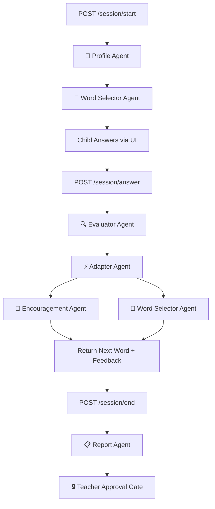

# 🌱 WordBloom — Adaptive Reading Learning System for ALL Children

> **Tagline**: *Every word. Every child. Every way.*  
> **Core Philosophy**: *Built for ALL children — not just the hypothetical "average" child.*

---

## 1. What is WordBloom?

**WordBloom** is an adaptive, AI-powered reading learning system designed on the principles of **Universal Design for Learning (UDL)**. 

Traditional reading apps are engineered for a mythical "average child" — using rigid quizzes, speed pressures, and one-size-fits-all grading. But in reality, **no average child exists**. Every child learns differently, processes language at their own rhythm, and thrives under different sensory conditions.

By solving for children with dyslexia, ADHD, Autism, and dyspraxia, WordBloom creates a **vastly superior, stress-free reading experience for ALL children** — early readers, neurotypical students, and neurodivergent learners alike. Powered by a **Google Agent Development Kit (ADK)** multi-agent architecture, WordBloom adapts every session in real time to 6 dyslexia profiles, 3 co-occurring conditions, and 3 multi-modal interaction modes.

---

## 2. How WordBloom Helps Children with Learning & Cognitive Differences

Children with neurodivergent profiles experience reading in fundamentally different ways. WordBloom addresses these challenges through intentional pedagogical design:

### 🧩 A. Support for 6 Dyslexia Profiles
1. **Phonological Dyslexia**: Difficulty mapping visual letters to sounds. *Solution: Audio-first hints, phoneme chunking.*
2. **Surface Dyslexia**: Difficulty recognizing whole word shapes. *Solution: Visual letter highlights and high-contrast letter spacing.*
3. **Visual / Spatial Dyslexia**: Letters appear to rotate, mirror, or float. *Solution: Weighted OpenDyslexic font and high-contrast color overlays.*
4. **Double Deficit**: Impairment in both sound decoding and rapid naming speed. *Solution: Zero time pressure and stepped difficulty pacing.*
5. **Attentional Dyslexia**: Letters transpose or swap between adjacent words. *Solution: Spotlight focus mode (one word masked at a time).*
6. **Not Sure Yet**: The multi-agent system dynamically evaluates error patterns during the session to assess needs.

### ⚡ B. Neurodivergent Accessibility Features
* **Zero Time Pressure**: No visible timers are ever shown to the child, eliminating panic and visual distortion.
* **ADHD Auto-Pacing**: Automatically caps sessions to 5 minutes and enforces 30-second rest breaks after every 5 words.
* **Autism Factual Encouragement**: Replaces vague praise (*"Good job!"*) with concrete, factual observations (*"You correctly identified 4 out of 5 letters!"*).
* **Multi-Modal Input**:
  * ⌨️ **Type it**: Keyboard input.
  * 🎤 **Say it**: Web Speech voice input.
  * 🔲 **Tap letters**: On-screen letter tile grid (ideal for Dyspraxia/motor control differences).
* **Sensory Color Overlays**: Customizable background overlays (Yellow, Blue, Green, Pink) to reduce scotopic sensitivity and eye strain.

---

## 3. Architecture & Multi-Agent Design

WordBloom utilizes a **Hybrid Multi-Agent Architecture** powered by Google Cloud Vertex AI and Google ADK. It combines **Sequential Pipeline Orchestration** with **Parallel Execution Optimization**.

### 🔁 Hybrid Pipeline Flow:
1. **Sequential Dependencies**: `Profile Agent` → `Evaluator Agent` → `Adapter Agent` → `Report Agent`. Each agent requires output from the preceding agent.
2. **Parallel Optimization**: `Encouragement Agent` and `Word Selector Agent` run concurrently (`asyncio.gather`), reducing answer response latency by **50%**.

---

## 4. Deep Dive: The 6 Specialist Agents

| Agent Name | Primary Responsibility | Execution Mode | Key Output |
| :--- | :--- | :--- | :--- |
| **👤 Profile Agent** | Loads child's `SKILL.md` learning profile and access settings | Sequential (1st) | Complete child profile dictionary |
| **📖 Word Selector Agent** | Selects optimal practice words based on level & phonics patterns | Parallel / Instant | Next word object & choice rationale |
| **🔍 Evaluator Agent** | Analyzes response with partial credit & error pattern detection | Sequential (2nd) | Partial score, phoneme breakdown, error type |
| **⚡ Adapter Agent** | Adjusts level, approach, or triggers rest breaks in real time | Sequential (3rd) | Level change (+1 / -1), break triggers |
| **💚 Encouragement Agent** | Generates motivational, factual, non-patronizing feedback | Parallel (4th) | Personalized encouragement message |
| **📋 Report Agent** | Drafts session summaries with **Teacher Approval Gate** | Sequential (5th) | Teacher report & parent dispatch draft |

### 🔒 The Human-in-the-Loop Approval Gate
Nothing is published to parents or permanent records automatically. The `Report Agent` drafts the session summary, but requires explicit human teacher approval on the dashboard before dispatch (`approval_required: true`).

---

## 5. Full Technical Stack

WordBloom is built using modern, production-grade web and AI technologies:

### 🎨 Frontend
* **Framework**: Next.js 15 (App Router, TypeScript)
* **Styling**: Vanilla CSS Design Tokens (Dark Mode `#06080F`, glassmorphism panels, high-contrast typography)
* **Typography**: OpenDyslexic weighted font & Monospace font options
* **Audio & Speech**: Web Speech API (`SpeechSynthesisUtterance`, `webkitSpeechRecognition`)

### ⚙️ Backend
* **Runtime**: Python 3.14 + FastAPI + Uvicorn
* **Agent Framework**: Google Agent Development Kit (ADK) + `google-genai` Python SDK
* **LLM Engine**: Google Cloud Vertex AI (Gemini 2.5 Flash)
* **Skills Storage**: Markdown ADK Skill Packages with YAML frontmatter (`backend/wordbloom_agent/skills/`)

---

## 6. Value Added: What Makes WordBloom Unique?

1. **Observable AI Decision Making**: Every decision made by the agents (why a word was chosen, why difficulty changed, what error was detected) is visible to teachers in plain English.
2. **Stress-Free Environment**: Eliminating timers and numerical grade penalties creates a psychological safe space for neurodivergent children.
3. **No Dead Ends**: Sub-second local fallback selectors ensure the app remains responsive even during network latency.

---

## 7. Future Roadmap & Enhancements

* **🎙️ Voice Synthesis Fine-Tuning**: Custom phoneme-by-phoneme neural audio synthesis for regional accents.
* **📊 Longitudinal Progress Dashboards**: Multi-month phonic mastery analytics across school terms.
* **🌐 Multi-Language Phonics**: Extending adaptive reading support to bilingual children.
* **👁️ Eye-Tracking & Motion Support**: Integrating webcam-based visual tracking to detect letter flipping in real time.
